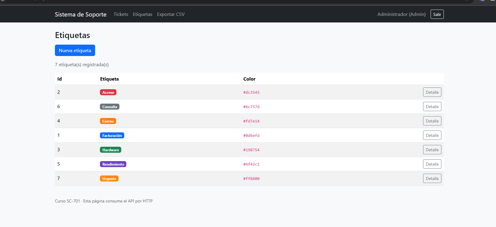
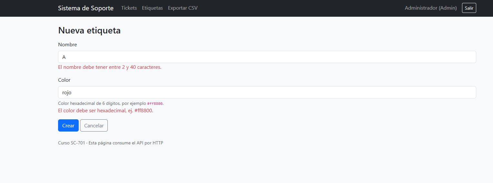
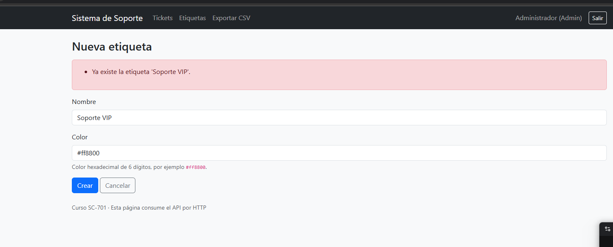

# Práctica programada 3: Etiquetas en el MVC

Curso: **SC-701 Programación Avanzada Web (.NET)**

---

## Parte B: Investigación

### 1. ¿Qué es el patrón Post-Redirect-Get y qué problema concreto evita? Explíquelo con lo que pasaría si lo omite y el usuario presiona F5.

Post-Redirect-Get (PRG) es un patrón para formularios web donde, después de procesar con éxito una petición `POST`, el servidor responde con una redirección HTTP (`302 Found`) hacia una ruta `GET` (por ejemplo, la página de detalle del recurso recién creado) en lugar de devolver HTML directamente. Su objetivo concreto es evitar el reenvío accidental del formulario cuando el usuario recarga la página o navega con el historial. Si en `EtiquetasController.Crear` se omitiera la redirección y se devolviera `View(...)` directo tras crear la etiqueta, la última petición registrada por el navegador seguiría siendo el `POST`. Al presionar **F5**, el navegador reenviaría los mismos datos del formulario: en un módulo como Tickets se crearía un registro duplicado, y en Etiquetas el API respondería un error `409 Conflict` porque el nombre ya existe. Con PRG (`RedirectToAction(nameof(Detalle), new { id = creada.Id })`), presionar **F5** únicamente repite el `GET` del detalle de forma segura.

- **Fuente:** [Microsoft Learn — ASP.NET Core MVC Controller Action Return Types](https://learn.microsoft.com/en-us/aspnet/core/web-api/action-return-types) y [MDN Web Docs — HTTP Redirections](https://developer.mozilla.org/en-US/docs/Web/HTTP/Guides/Redirections).

---

### 2. El cliente tipado se registra con `AddHttpClient<TInterfaz, TImplementacion>`. ¿Qué tiempo de vida (Transient, Scoped o Singleton) tiene y por qué no conviene que sea Singleton ni crear `new HttpClient()` a mano?

Cuando se registra un cliente tipado con `AddHttpClient<IEtiquetasApi, EtiquetasApi>`, ASP.NET Core lo registra con tiempo de vida **Transient**: cada vez que se inyecta se entrega una instancia nueva de `EtiquetasApi`, pero `IHttpClientFactory` administra internamente un *pool* de `HttpMessageHandler` que reutiliza las conexiones TCP y rota los handlers cada 2 minutos por defecto. No conviene registrar un cliente tipado como **Singleton** porque mantendría el mismo `HttpMessageHandler` indefinidamente, impidiendo que la aplicación detecte cambios de DNS si cambia la IP del servidor del API (además de provocar dependencias cautivas si se mezclan servicios no Singleton). Tampoco conviene instanciar `new HttpClient()` a mano en cada petición, porque aunque se libere con `using`, los sockets subyacentes quedan en estado `TIME_WAIT` durante varios minutos y, bajo tráfico concurrente, esto agota los puertos disponibles del sistema (*socket exhaustion*).

- **Fuente:** [Microsoft Learn — Make HTTP requests using IHttpClientFactory in ASP.NET Core](https://learn.microsoft.com/en-us/aspnet/core/fundamentals/http-requests).

---

### 3. ¿Qué es `ProblemDetails` (RFC 9457)? Nombre los campos que su MVC lee y diga cuál es la diferencia entre el formato de un 400 de validación y el de un 409.

`ProblemDetails` (definido en el estándar **RFC 9457**, con tipo de contenido `application/problem+json`) es un formato JSON estandarizado para comunicar errores HTTP legibles tanto por máquinas como por personas, evitando que cada endpoint invente su propia estructura de error. En este proyecto, el MVC deserializa en `ApiException.ProblemaApi` los campos **`title`**, **`detail`** y **`errors`** (además de leer el código HTTP de la respuesta). La diferencia entre ambos códigos está en la granularidad del JSON: un **`400 Bad Request`** de validación utiliza `ValidationProblemDetails` y trae el diccionario `errors` indexado por nombre de propiedad (por ejemplo, `"Nombre"` y `"Color"`), lo que permite a `EtiquetasController` asociar cada mensaje al campo correspondiente en la vista; en cambio, un **`409 Conflict`** (nombre repetido) devuelve un `ProblemDetails` estándar con `title` y `detail` (*"Ya existe la etiqueta '...'"*) pero sin `errors`, por lo que el controlador lo registra con clave vacía para mostrarlo como mensaje general en `asp-validation-summary="ModelOnly"`.

- **Fuente:** [IETF RFC 9457 — Problem Details for HTTP APIs](https://www.rfc-editor.org/rfc/rfc9457) y [Microsoft Learn — Handle errors in ASP.NET Core APIs](https://learn.microsoft.com/en-us/aspnet/core/web-api/handle-errors).

---

### 4. ¿Qué ataque previene `[ValidateAntiForgeryToken]`? Explique cómo lo hace ASP.NET Core y qué se pone en el formulario.

`[ValidateAntiForgeryToken]` previene ataques **CSRF** (*Cross-Site Request Forgery* o falsificación de petición entre sitios), en los cuales una página maliciosa engaña al navegador de un usuario ya autenticado para que envíe un `POST` hacia nuestra aplicación aprovechando que el navegador adjunta automáticamente la cookie de sesión. ASP.NET Core lo bloquea generando un par de tokens criptográficos vinculados: uno se almacena en una cookie antiforgery (`HttpOnly`) y el otro se incrusta en el HTML del formulario dentro del campo oculto `__RequestVerificationToken`. Cuando llega el `POST`, el atributo verifica que ambos tokens estén presentes y coincidan; como un sitio externo no puede leer el contenido HTML de nuestro dominio por la política del mismo origen, no puede incluir el token válido y la petición es rechazada con `400 Bad Request`. En el formulario Razor, al usar el Tag Helper `<form method="post" asp-action="Crear">`, ASP.NET Core inyecta el campo oculto automáticamente (también puede escribirse manualmente con `@Html.AntiForgeryToken()`).

- **Fuente:** [Microsoft Learn — Prevent Cross-Site Request Forgery (XSRF/CSRF) attacks in ASP.NET Core](https://learn.microsoft.com/en-us/aspnet/core/security/anti-request-forgery).

---

### 5. Compare `ViewData`, `ViewBag`, `TempData` y un modelo tipado: ¿cuándo usaría cada uno? Dé un ejemplo de su propia práctica.

Un **modelo tipado (`@model`)** es la forma recomendada para pasar los datos principales de una vista, ya que ofrece comprobación de tipos en tiempo de compilación y autocompletado; en esta práctica se usa `@model List<EtiquetaVm>` en `Index`, `@model EtiquetaVm` en `Detalle` y `@model EtiquetaCrearVm` en `Crear`. **`ViewData`** es un diccionario clave-valor que vive solo durante la petición actual y sirve para metadatos pequeños compartidos con el layout o vistas parciales, como `ViewData["Title"] = "Etiquetas"` que luego lee `_Layout.cshtml`. **`ViewBag`** es un envoltorio dinámico sobre el mismo diccionario de `ViewData` que evita conversiones explícitas pero pierde validación en compilación, por lo que suele reservarse para valores auxiliares simples cuando no se desea usar sintaxis de diccionario. Finalmente, **`TempData`** conserva información entre una petición y la siguiente (respaldada por cookie por defecto) y se elimina al leerse, por lo que se usa para mensajes tras una redirección PRG, como `TempData["Exito"] = $"Etiqueta '{creada.Nombre}' creada.";` mostrado en `_Layout.cshtml` al aterrizar en `Detalle`.

- **Fuente:** [Microsoft Learn — Views in ASP.NET Core MVC](https://learn.microsoft.com/en-us/aspnet/core/mvc/views/overview) y [Microsoft Learn — Session and state management in ASP.NET Core](https://learn.microsoft.com/en-us/aspnet/core/fundamentals/app-state).

---

## Evidencias

Las tres capturas requeridas se encuentran en la carpeta `docs/evidencia/`:

1. **Lista de etiquetas con la vista parcial `_InsigniaColor` funcionando:**
   
2. **Formulario de creación con error de validación bajo un campo:**
   
3. **Formulario de creación con mensaje de nombre repetido (409):**
   

---

## Declaración de uso de herramientas de apoyo (Sección 8)

Para el desarrollo de esta práctica se consultó la documentación oficial de Microsoft Learn y RFC 9457, así como la herramienta de inteligencia artificial **Antigravity (Gemini)** como apoyo para analizar la arquitectura existente del proyecto (`Tickets`)
